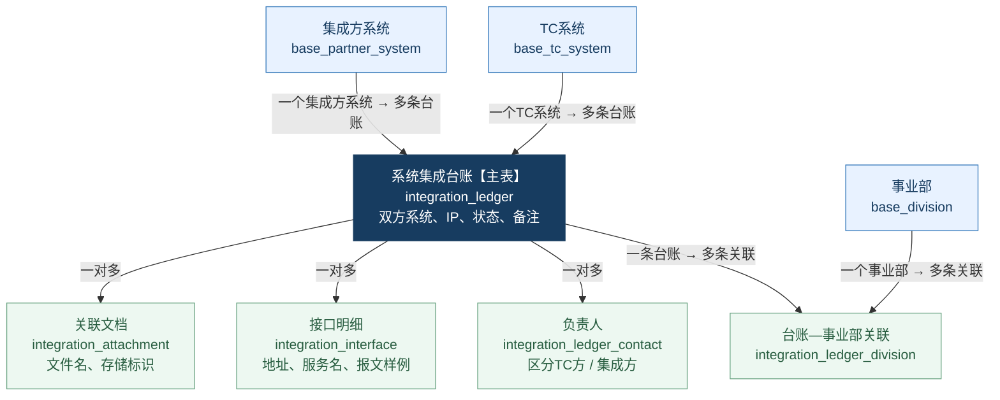
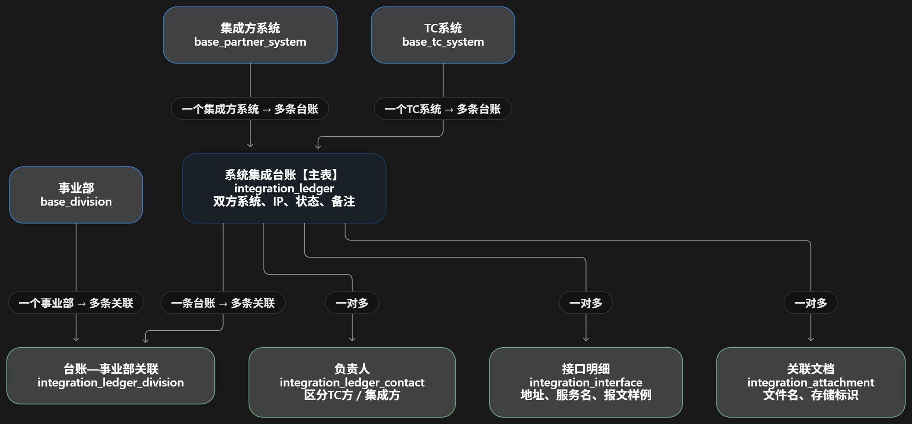

# 数据库表关系说明

**核心是“系统集成台账”主表**：一条台账记录“哪个 TC 系统，与哪个集成方系统进行集成”，再关联事业部、负责人、接口和文档。

**用一个例子理解：**

| 内容 | 保存位置 | 示例 |
|---|---|---|
| 哪两个系统集成 | 台账主表 | 集团 TC PLM ↔ ERP |
| 涉及哪些事业部 | 事业部关联表 | 工程院、乘用车事业部，各存一条关联 |
| 谁负责 | 负责人表 | TC方张三、李四；集成方王工，各存一条 |
| 有哪些接口 | 接口明细表 | 用户查询、订单同步，各存一条 |
| 有哪些文档 | 关联文档表 | 接口说明.pdf、联调说明.docx，各存一条 |

**事业部是多对多关系**：一条台账可以涉及多个事业部，一个事业部也可以参与多条台账，因此中间需要一张“台账—事业部关联表”。

另外两张表 `schema_migrations`、`demo_seed_runs` 分别记录建表版本和假数据初始化情况，**没有业务外键关系**，所以没有画进上图。

删除规则是：已被引用的基础数据禁止删除；删除台账时，会同时删除它所属的事业部关联、负责人、接口明细和文档关联记录。

## PNG 关系图

